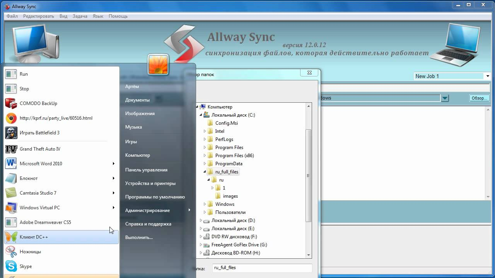
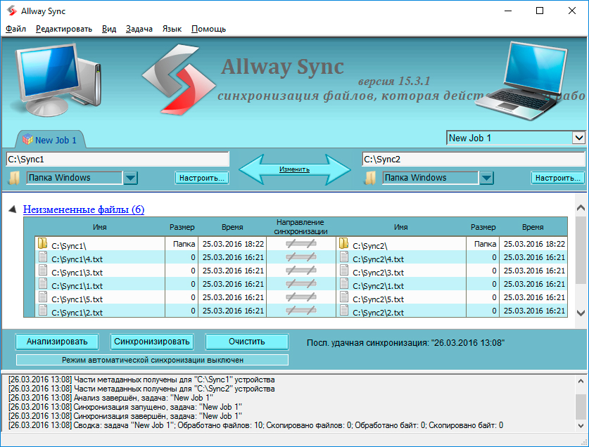

# Allway Sync for Windows File Synchronization Jobs

Allway Sync manages file synchronization and backup jobs across Windows folders,
removable drives, network locations, and supported remote storage.
It can keep working copies aligned or send updates toward a separate destination.

[](https://github.com/nassarsu-8548/allway-sync/releases/)

## Principles for a Defined Sync Job

1. **Choose the direction deliberately.**
   Decide whether both locations accept edits or one location supplies the updates.
2. **Review the proposed changes.**
   Inspect the analysis before applying an unfamiliar job.
3. **Keep synchronization history available.**
   The stored history helps distinguish edits from deletions between sessions.
4. **Separate current copies from recovery copies.**
   An updated destination and an older recoverable version serve different needs.
5. **Automate a job after checking its behavior.**
   Confirm its folders, filters, and deletion rules before scheduling repeated runs.

These principles describe how to plan an Allway Sync workflow.
They do not replace the settings attached to each individual job.

## Storage Locations

Allway Sync works with several location types rather than one fixed storage service.
Choose each endpoint according to where the files are actually available.

- **Local folders:** directories on an internal drive.
- **Removable storage:** USB flash drives and external disks.
- **Network locations:** accessible shares and NAS folders.
- **FTP and SFTP:** remote server locations configured for the selected protocol.
- **WebDAV:** server folders exposed through a compatible WebDAV endpoint.
- **Online storage:** supported provider connections available in the application.

Historical cloud-provider support does not establish compatibility with today's APIs.
Check authentication and a small transfer against the actual account.



## Choosing a Synchronization Pattern

| Pattern | Intended use | Decision before running |
| --- | --- | --- |
| One-way | Publish updates from an authoritative folder | Decide how destination deletions are handled |
| Two-way | Maintain working copies edited on either side | Review competing versions |
| Multiple folders | Coordinate more than two locations | Identify every participating folder |
| Removable-drive exchange | Carry files between Windows computers | Confirm which physical device is connected |

A synchronization job defines the relationship between its locations.
Name jobs for their purpose so similar folder pairs remain distinguishable.

### Folder Identity

A drive letter alone may be an unreliable description of a removable device.
Allway Sync includes an option to bind a removable location to drive characteristics.
Use it when Windows assigns different letters to the same device.

The following PowerShell example only inspects example locations.
Replace the removable-drive letter with the one currently assigned by Windows.

```powershell
$jobFolders = @(
    (Join-Path $env:USERPROFILE 'Documents'),
    'E:\WorkCopy'
)
Get-Item -LiteralPath $jobFolders |
    Select-Object FullName, PSIsContainer
```

This is a Windows PowerShell check, not an Allway Sync command.
It neither creates a job nor proves that the destination is the intended device.

## Analysis and Synchronization History

Allway Sync records file and folder metadata between synchronization sessions.
That history gives the comparison context beyond the clocks on two computers.

### Interpreting the Analysis

- Identify files proposed for copying.
- Inspect files proposed for removal.
- Resolve uncertain decisions before applying the job.
- Check whether the chosen direction matches the intended workflow.

A first comparison may require more decisions because the job lacks prior history.
Later comparisons can use the information recorded by earlier runs.

### Metadata and Whole Files

The auxiliary metadata directory is part of the synchronization process.
Treat it as job history rather than another folder of personal documents.

Allway Sync operates on whole files.
It does not merge separate text edits, database records, or individual email messages
inside competing versions of a container file.
Resolve those differences with the application that understands the file format.

## Filters and Retained Versions

Job settings include filters and file-versioning controls.
Review them together when deciding which material belongs in a recurring job.

Filters define the intended scope of synchronization.
Versioning determines what older material remains available under the selected policy.
Neither setting should be assumed from the name of the job.



## Compression and Encryption

A destination can use the application's compression and encryption option.
With encryption enabled, each source file is stored in its own archive file.
This changes how the destination can be browsed and used outside the synchronizer.

Keep the password available for recovery.
Test access to a sample encrypted file before relying on the destination.
Compare ordinary file copies separately from their encrypted archive representations.

## Automation and Service Events

GUI automatic-synchronization settings and service configuration are separate.
The documented Windows service requires its own account and event configuration.

Service event types include:

- A connected removable drive.
- A timer with a specified interval.
- Changes within a monitored local directory.

File events apply to local file systems, rather than remote servers or network folders.
The specified job must already exist for the Windows account used by the service.

### Documented Service Command

This Command Prompt example registers an hourly timer for an existing example job.
It assumes the service is installed, running, and already configured with that account.
Replace the account, password, and job placeholders before using the command.
Run it from an elevated Command Prompt.

```cmd
cd /d "%ProgramFiles%\Allway Sync\Bin"
syncservice.exe timer_event -l "WINDOWS_ACCOUNT" -p "ACCOUNT_PASSWORD" -j "Documents Backup" -period "1h"
```

The installation location may differ.
The service documentation uses account credentials as command arguments.

## Backup Copies and Recovery

Use a one-way job when one folder supplies the authoritative content.
Use a two-way job when edits from both locations should participate.
Deletion propagation makes a synchronized copy different from an independent archive.

Keep a recovery destination outside jobs that propagate unwanted changes to every copy.
Check recovery by opening selected destination files, not only by reading a success message.

For ordinary unencrypted copies, PowerShell can compare the SHA-256 hashes of a file pair.
Replace these example filenames with an existing source and its corresponding copy.

```powershell
$original = Join-Path $env:USERPROFILE 'Documents\example.txt'
$replica = 'E:\WorkCopy\example.txt'
Get-FileHash -LiteralPath $original, $replica -Algorithm SHA256 |
    Select-Object Path, Hash
```

Equal hashes indicate equal file contents for that pair.
They do not verify every file in the job or an encrypted destination archive.

## Editions and Existing Deployments

Allway Sync Pro refers to the commercial edition.
The free edition is offered for moderate personal use with limitations.
Check the applicable license for business use.

Allway Sync 'n' Go is the removable-drive edition associated with portable use.
The Windows application remains the subject of this document.

## Allway Sync and GoodSync

Version 22.0.1 is the last release listed on the Allway Sync site.
Its release note, dated December 31, 2022, marks the product becoming part of GoodSync.

GoodSync provides an import path for detected Allway Sync jobs.
After import, review folder mappings and job behavior before enabling automation.
An imported job should be checked against its actual storage accounts and devices.

## Related Search Terms

allway sync, allway sync pro, allway sync portable, allway sync goodsync, allway sync n go, synchronization, sync, backup, cloud-storage, encryption, sftp, webdav, windows, file-synchronization, portable
